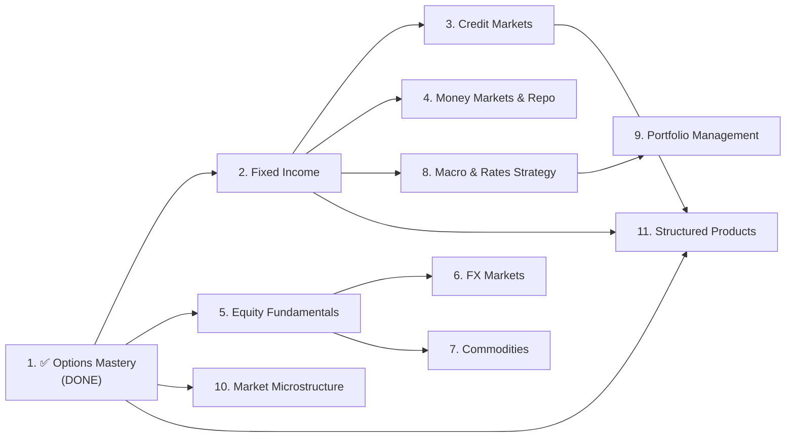

# Market Finance Mastery — Master Plan

> **Goal:** Build a suite of **11 standalone educational websites** covering the full breadth of Global Markets knowledge, each with a unique visual identity, hosted on GitHub Pages, and linked from a central portfolio hub.  
> **Career path:** Global Markets / S&T → Portfolio Management  
> **Standard:** Every site must match or exceed the depth, interactivity, and polish of **Options Mastery**.

---

## How Options Mastery Was Built (The Blueprint)

This section documents the process that produced Options Mastery so it can be replicated for every new topic. Each new conversation should follow this playbook.

### Architecture

| Layer | Choice |
|-------|--------|
| **Files** | Self-contained `.html` modules — no build step, no bundler, no npm |
| **Styling** | Vanilla CSS with CSS custom properties (dark theme) |
| **Logic** | Vanilla JavaScript — no React, no frameworks |
| **Math** | KaTeX 0.16.9 (CDN) with auto-render |
| **Charts** | HTML5 Canvas API — hand-drawn, no Chart.js or D3 |
| **Fonts** | Google Fonts CDN (Inter + JetBrains Mono) |
| **Hosting** | GitHub Pages — one repo per topic, static file serving |

### Module Structure (per HTML file)

Each module is a single HTML file (~60–130 KB, 900–2200 lines) containing:

```
┌─ <head>
│   ├── Meta + viewport + title
│   ├── Google Fonts <link>
│   ├── KaTeX CSS <link>
│   └── <style> — ALL CSS inline (no external stylesheet)
│        ├── CSS custom properties (:root)
│        ├── Layout (body, header, nav, card, grid)
│        ├── Component styles (tables, alerts, KPI cards, sliders)
│        ├── Chart wrapper + controls
│        ├── Mobile responsive block (@media max-width: 700px)
│        └── Scrollbar + footer
│
├─ <body>
│   ├── Header bar (< Back to Hub, Module Title, progress dots)
│   ├── Tab navigation (.nav-tab buttons)
│   ├── Tab content panels (one <div> per tab, shown/hidden)
│   │    ├── Concept cards with KaTeX math
│   │    ├── Interactive calculators (number inputs → KPI results)
│   │    ├── Canvas charts with slider controls
│   │    ├── Summary tables
│   │    └── Alert boxes (tips, warnings, key insights)
│   └── Footer
│
└─ <script>
     ├── KaTeX JS + auto-render (CDN)
     ├── Tab switching logic
     ├── Black-Scholes / pricing functions
     ├── Calculator functions (parse inputs → compute → display)
     ├── Canvas draw functions (axes, curves, legend, gridlines)
     ├── Hover tracking (mousemove → crosshair + tooltip + dot)
     ├── Reinit/reset functions per section
     └── window.onload / DOMContentLoaded init
```

### Quality Checklist (applied to every module)

Every module must pass this checklist before being marked ✅:

- [ ] **Input validation bounds** — all `<input type="number">` have `min`, `max`, `step`
- [ ] **Falsy value protection** — `r = 0%` and similar edge values handled (no `|| default` pattern)
- [ ] **Reinit buttons** — every interactive section has a "Reinit" button
- [ ] **Hover tracking** — all Canvas charts have crosshair, intersection dot, floating HUD tooltip
- [ ] **Mobile responsive** — tables scroll, grids stack, formulas scroll, controls compress on ≤700px
- [ ] **Math label casing** — `text-transform: none` on math symbols; Greek letters render correctly
- [ ] **Dead code cleanup** — no vestigial references to other modules
- [ ] **Interview Q&A section** — each module ends with key interview questions + concise answers

### Conversation Workflow (per topic)

Each topic gets its own directory and Antigravity conversation. The workflow is:

1. **Share course materials** (PDFs, slides, notes) if available
2. **Draft module outline** — agree on how many HTML files, what tabs each file contains
3. **Build module-by-module** — one HTML file at a time, starting from the landing `index.html`
4. **Review pass** — walk through each module applying the Quality Checklist
5. **Visual identity** — decide accent colors, header styling, background effects per topic
6. **Interview layer** — add Q&A cards / cheat sheets to each module
7. **Final commit & deploy** — push to GitHub, enable Pages, link from portfolio hub

### Scale Reference

Options Mastery totals:

| Metric | Value |
|--------|-------|
| HTML files | 11 (1 index + 10 modules) |
| Total lines of code | ~13,694 |
| Total file size | ~825 KB |
| Interactive Canvas charts | ~30+ |
| Tabs across all modules | ~35 |
| Development time | ~3 months of iterative conversations |

---

## The 10 Topics

### Overview Table

| # | Topic | Directory Name | Depth | Key Focus |
|---|-------|---------------|-------|-----------|
| 1 | ✅ Options & Derivatives | `Derivatives_Academy/` | 🔴 Math-heavy | BSM, Greeks, volatility surfaces |
| 2 | Fixed Income | `Fixed_Income_Academy/` | 🔴 Math-heavy | Yield curves, duration, convexity, swaps |
| 3 | Credit Markets | `Credit_Academy/` | 🔴 Math-heavy | CDS, spreads, default models, credit curves |
| 4 | FX Markets | `FX_Academy/` | 🟡 Balanced | Crosses, forwards, swaps, carry, PPP |
| 5 | Commodities | `Commodities_Academy/` | 🟡 Balanced | Curves, storage, seasonality, energy/metals/agri |
| 6 | Equity Cash & Fundamentals | `Equity_Academy/` | 🟡 Balanced | Valuation, multiples, sector rotation, indices |
| 7 | Macro & Rates Strategy | `Macro_Rates_Academy/` | 🟡 Balanced | Central banks, curve trades, macro indicators |
| 8 | Money Markets & Repo | `Money_Markets_Academy/` | 🟡 Balanced | Short-end rates, repo mechanics, funding |
| 9 | Portfolio Management | `Portfolio_Academy/` | 🔴 Math-heavy | MPT, factor models, risk budgeting, attribution |
| 10 | Market Microstructure | `Microstructure_Academy/` | 🟡 Balanced | Order books, market making, execution algos |
| 11 | Structured Products | `Structured_Products_Academy/` | 🔴 Math-heavy | Product catalog by asset class, payoffs, sensitivities |

> [!NOTE]
> Structured Products intentionally overlaps with Options and Fixed Income. The difference is the angle: Options/FI teach the *building blocks*, while Structured Products is a **product catalog** — "here's a product, here's how it works, here's who buys it and why."

---

## Detailed Topic Breakdowns

### 2. Fixed Income Academy

**Why it matters:** The largest asset class in the world. Core to any rates/credit trading desk. Heavy on math — perfect for the Options Mastery treatment.

#### Proposed Modules

| # | File | Topic | Key Interactive Elements |
|---|------|-------|------------------------|
| 01 | `01_Bond_Basics.html` | Bond pricing, accrued interest, day-count conventions, clean vs dirty price | Bond price calculator, accrued interest tool |
| 02 | `02_Yield_Measures.html` | YTM, current yield, spot rates, forward rates, bootstrapping | Yield calculator, bootstrap visualizer |
| 03 | `03_Term_Structure.html` | Yield curve shapes, theories (expectations, liquidity pref, segmented), curve construction | Interactive yield curve builder, theory comparisons |
| 04 | `04_Duration_Convexity.html` | Macaulay / Modified / Effective duration, Dollar duration, convexity adjustment | Duration calculator, price-yield curve with tangent lines |
| 05 | `05_Interest_Rate_Risk.html` | DV01, key-rate durations, PV01, portfolio hedging with futures | DV01 calculator, hedging simulator |
| 06 | `06_Swaps.html` | IRS mechanics, swap pricing, swap spreads, OIS, basis swaps | Swap pricer, fixed vs floating cash flow visualizer |
| 07 | `07_Bond_Futures.html` | CTD, conversion factors, basis trading, delivery option | CTD finder, basis calculator |
| 08 | `08_Inflation_Linked.html` | TIPS/linkers, breakeven inflation, real vs nominal yields | Breakeven calculator, real yield curve |
| 09 | `09_Structured_FI.html` | Callable/putable bonds, MBS basics, ABS, OAS | OAS calculator, prepayment model visualizer |
| 10 | `10_FI_Interview_Cheatsheet.html` | Key formulas, common interview questions, quick-reference tables | Flashcard-style Q&A with reveal |

---

### 3. Credit Academy

**Why it matters:** Credit desks are among the most active in global markets. CDS mechanics and credit modeling are heavily tested in interviews.

#### Proposed Modules

| # | File | Topic |
|---|------|-------|
| 01 | `01_Credit_Fundamentals.html` | Credit risk, recovery rates, LGD, probability of default |
| 02 | `02_Credit_Spreads.html` | Spread types (Z-spread, ASW, OAS), spread drivers, relative value |
| 03 | `03_CDS_Mechanics.html` | CDS contracts, premium/protection legs, standard coupons, Big Bang protocol |
| 04 | `04_CDS_Pricing.html` | Hazard rates, survival probabilities, CDS pricing from credit curves |
| 05 | `05_Credit_Curves.html` | Bootstrapping credit curves, term structure of default, curve trades |
| 06 | `06_Credit_Indices.html` | CDX, iTraxx, index tranches, correlation trading basics |
| 07 | `07_Credit_Events.html` | Defaults, restructuring, succession, auction mechanics |
| 08 | `08_Credit_Interview.html` | Key Q&A, formulas, market conventions cheat sheet |

---

### 4. FX Academy

**Why it matters:** The most liquid market in the world. Every Global Markets desk interacts with FX. More intuition-based but with precise conventions.

#### Proposed Modules

| # | File | Topic |
|---|------|-------|
| 01 | `01_FX_Basics.html` | Quote conventions, bid/ask, crosses, major/minor/exotic pairs |
| 02 | `02_FX_Forwards.html` | Covered interest rate parity, forward points, NDF mechanics |
| 03 | `03_FX_Swaps.html` | FX swap mechanics, roll conventions, basis swaps |
| 04 | `04_FX_Options.html` | FX vol conventions (delta vs strike), risk reversals, butterflies, smile |
| 05 | `05_FX_Carry.html` | Carry trade mechanics, uncovered interest parity, G10 carry |
| 06 | `06_FX_Macro.html` | PPP, BEER/FEER, current account, terms of trade, central bank intervention |
| 07 | `07_EM_FX.html` | EM-specific risks, real rates, reserves, capital controls |
| 08 | `08_FX_Interview.html` | Key Q&A, conventions cheat sheet, mental math for crosses |

---

### 5. Commodities Academy

**Why it matters:** Unique asset class with physical delivery, storage costs, and seasonality. Energy and metals desks are major P&L centers.

#### Proposed Modules

| # | File | Topic |
|---|------|-------|
| 01 | `01_Commodity_Basics.html` | Physical vs financial, spot vs futures, key exchanges |
| 02 | `02_Futures_Curves.html` | Contango, backwardation, convenience yield, cost of carry |
| 03 | `03_Energy.html` | Crude oil (WTI/Brent), natural gas, refining margins, crack spreads |
| 04 | `04_Metals.html` | Precious (gold, silver) vs base (copper, aluminum), LME conventions |
| 05 | `05_Agriculture.html` | Grains, softs, seasonality, weather risk, crop cycles |
| 06 | `06_Commodity_Trading.html` | Spread trading, calendar rolls, location spreads, storage plays |
| 07 | `07_Commodity_Risk.html` | Hedging for producers/consumers, basis risk, volumetric risk |
| 08 | `08_Commodity_Interview.html` | Key Q&A, market conventions, mental frameworks |

---

### 6. Equity Cash & Fundamentals Academy

**Why it matters:** Foundational for any markets role. Even rates/credit traders need equity literacy. Core to PM interviews.

#### Proposed Modules

| # | File | Topic |
|---|------|-------|
| 01 | `01_Equity_Basics.html` | Share types, rights, corporate actions, indices |
| 02 | `02_Valuation_DCF.html` | DCF, WACC, terminal value, FCF modeling |
| 03 | `03_Valuation_Multiples.html` | P/E, EV/EBITDA, P/B, PEG — when to use which, comps methodology |
| 04 | `04_Financial_Statements.html` | Income statement, balance sheet, cash flow — reading & linking the three |
| 05 | `05_Sector_Rotation.html` | Business cycle, sector beta, defensive vs cyclical, style factors |
| 06 | `06_Indices_ETFs.html` | Index construction, rebalancing, ETF mechanics, tracking error |
| 07 | `07_Corporate_Actions.html` | Dividends, splits, buybacks, M&A — impact on price and Greeks |
| 08 | `08_Equity_Interview.html` | Pitch a stock, key ratios, quick valuation frameworks |

---

### 7. Macro & Rates Strategy Academy

**Why it matters:** The intellectual backbone of rates trading and macro PM. Ties everything together — central banks, curves, global flows.

#### Proposed Modules

| # | File | Topic |
|---|------|-------|
| 01 | `01_Macro_Framework.html` | GDP, inflation, employment — how to read the macro cycle |
| 02 | `02_Central_Banks.html` | Fed, ECB, BoJ, BoE — mandates, tools, forward guidance, dot plots |
| 03 | `03_Yield_Curve_Trades.html` | Steepeners, flatteners, butterflies, barbell vs bullet |
| 04 | `04_Inflation_Trading.html` | Breakevens, real rates, inflation swaps, TIPS vs nominals |
| 05 | `05_Global_Flows.html` | Capital flows, balance of payments, reserve management |
| 06 | `06_Economic_Indicators.html` | NFP, CPI, PMI, housing — how markets react, surprise indices |
| 07 | `07_Macro_Regimes.html` | Risk-on/risk-off, correlation regimes, cross-asset signals |
| 08 | `08_Macro_Interview.html` | "Where are rates going?" frameworks, market view construction |

---

### 8. Money Markets & Repo Academy

**Why it matters:** The plumbing of the financial system. Critical for understanding funding, collateral, and central bank operations. Often neglected in prep but heavily tested on rates desks.

#### Proposed Modules

| # | File | Topic |
|---|------|-------|
| 01 | `01_Money_Market_Basics.html` | T-bills, CP, CD, BA — instruments and conventions |
| 02 | `02_Repo_Mechanics.html` | Repo/reverse repo, haircuts, collateral, term vs overnight |
| 03 | `03_Central_Bank_Ops.html` | OMO, standing facilities, reserve requirements, QE/QT mechanics |
| 04 | `04_Funding_Rates.html` | SOFR, €STR, SONIA — transition from LIBOR, compounding conventions |
| 05 | `05_Collateral.html` | GC vs special, fails, settlement, tri-party |
| 06 | `06_Money_Market_Interview.html` | Key Q&A, rate calculations, day-count conventions |

---

### 9. Portfolio Management Academy

**Why it matters:** The destination career. Ties together all asset classes. Heavy on math (optimization, factor models, risk).

#### Proposed Modules

| # | File | Topic |
|---|------|-------|
| 01 | `01_MPT_Basics.html` | Mean-variance, efficient frontier, capital market line, Sharpe ratio |
| 02 | `02_CAPM_APT.html` | CAPM, beta, SML, Arbitrage Pricing Theory, multi-factor |
| 03 | `03_Factor_Models.html` | Fama-French, momentum, quality, value — factor construction |
| 04 | `04_Risk_Budgeting.html` | VaR, CVaR, risk parity, marginal risk contribution |
| 05 | `05_Performance_Attribution.html` | Brinson attribution, factor attribution, alpha vs beta decomposition |
| 06 | `06_Asset_Allocation.html` | Strategic vs tactical, Black-Litterman, regime-based allocation |
| 07 | `07_Portfolio_Construction.html` | Constraints, rebalancing, transaction costs, tax efficiency |
| 08 | `08_Alternative_Investments.html` | Hedge funds, PE, real estate — role in portfolio, illiquidity premium |
| 09 | `09_ESG_Integration.html` | ESG factors, screening, impact investing, carbon risk |
| 10 | `10_PM_Interview.html` | "Build me a portfolio" frameworks, risk/return trade-offs |

---

### 10. Market Microstructure Academy

**Why it matters:** Understanding how markets actually work at the execution level. Critical for electronic trading, market making, and understanding price formation.

#### Proposed Modules

| # | File | Topic |
|---|------|-------|
| 01 | `01_Market_Structure.html` | Exchanges vs OTC, order types, matching engines, dark pools |
| 02 | `02_Order_Book.html` | Limit order book mechanics, depth, spread, queue priority |
| 03 | `03_Market_Making.html` | Bid-ask dynamics, inventory risk, adverse selection, Avellaneda-Stoikov |
| 04 | `04_Price_Discovery.html` | Information in order flow, Kyle's lambda, informed vs noise traders |
| 05 | `05_Execution.html` | TWAP, VWAP, implementation shortfall, optimal execution |
| 06 | `06_Market_Impact.html` | Temporary vs permanent impact, Almgren-Chriss, slippage |
| 07 | `07_Regulation.html` | MiFID II, Reg NMS, best execution, transparency requirements |
| 08 | `08_Microstructure_Interview.html` | Key Q&A, market making scenarios, order book exercises |

---

### 11. Structured Products Academy

**Why it matters:** Structured products sit at the intersection of derivatives, fixed income, and client-facing sales. Understanding them demonstrates you can connect the math to actual traded products. This site takes a **product-catalog approach** — organized by underlying asset class, each product gets its own "product sheet" with payoff diagrams, sensitivity profiles, pricing intuition, and real-world use cases.

#### Proposed Modules

| # | File | Topic | Key Interactive Elements |
|---|------|-------|------------------------|
| 01 | `01_Structuring_101.html` | What is a structured product? Issuer vs investor perspective, regulatory wrapper (notes, certificates), fee structure, secondary market | Visual breakdown: wrapper + underlying + payoff |
| 02 | `02_Equity_Linked.html` | Autocallables (Phoenix, Athena), reverse convertibles, capital-protected notes, bonus certificates, discount certificates, tracker certificates | Payoff builder per product, barrier visualizer, scenario simulator |
| 03 | `03_Rate_Linked.html` | CMS-linked notes, range accruals, steepener/flattener notes, callable range accruals, snowball/snowbear coupons, TARNs | Coupon accrual simulator, rate path scenarios |
| 04 | `04_FX_Linked.html` | Dual currency deposits, FX-linked notes, PRDCs (Power Reverse Dual Currency), quanto structures, FX accumulators | Payoff vs spot path, worst-of FX visualizer |
| 05 | `05_Credit_Linked.html` | CLNs (Credit-Linked Notes), synthetic CDOs (first-to-default baskets), principal-at-risk notes | Default scenario simulator, tranche loss visualizer |
| 06 | `06_Commodity_Linked.html` | Capital-protected commodity notes, participation certificates, commodity range accruals, oil/gold-linked structures | Commodity payoff simulator with spot curve |
| 07 | `07_Exotic_Payoffs.html` | Worst-of mechanics, best-of, lookback, cliquet/ratchet, himalaya, Napoleon — the exotic building blocks used across asset classes | Interactive exotic payoff explorer |
| 08 | `08_Risk_Sensitivities.html` | How each product type behaves: Delta/Gamma/Vega/Rho profiles, barrier Greeks, correlation sensitivity, key risk factors by product | Side-by-side sensitivity comparison tool |
| 09 | `09_Lifecycle.html` | Issuance, secondary market pricing, early redemption/autocall triggers, maturity scenarios, issuer credit risk | Timeline visualizer with event triggers |
| 10 | `10_Structuring_Interview.html` | "Decompose this product into vanilla components", "Who buys this and why?", common structuring interview Q&A | Flashcard decomposition exercises |

> [!TIP]
> The **unique value** of this site vs Options/FI: each product module is structured like a **product sheet** — not "here's the math behind a barrier" but "here's an autocallable: who buys it, what it's made of, what kills you, what the client sees vs what the desk sees."

---

## Suggested Build Order

The order is designed to maximize **interview readiness** and build knowledge **from foundational → specialized**:



| Phase | Topics | Rationale |
|-------|--------|-----------|
| **Phase 1** | Fixed Income → Credit → Money Markets | The rates complex — builds on Options math, core to S&T |
| **Phase 2** | Equity → FX → Commodities | The other major asset classes — more intuition, broader coverage |
| **Phase 3** | Macro & Rates Strategy | Ties Phases 1 & 2 together — the "big picture" |
| **Phase 4** | Structured Products | Product catalog — best built after Options + FI + Credit are done so you can reference them |
| **Phase 5** | Portfolio Management | The PM endgame — requires knowledge from all prior phases |
| **Phase 6** | Market Microstructure | Execution & trading mechanics — complementary to everything |

> [!TIP]
> You don't need to finish each topic before starting the next. Phase 1 and Phase 2 can run in parallel since they don't depend on each other.

---

## Directory & Repo Structure

Each topic lives in its own GitHub repo and directory:

```
GitHub Profile
├── Options-Mastery/           ← ✅ DONE (Derivatives_Academy/Refined_Notes/)
│   ├── index.html
│   ├── 01_Forwards_Futures.html
│   ├── ...
│   └── README.md
│
├── Fixed-Income-Academy/      ← Next up
│   ├── index.html
│   ├── 01_Bond_Basics.html
│   ├── ...
│   └── README.md
│
├── Credit-Academy/
├── FX-Academy/
├── Commodities-Academy/
├── Equity-Academy/
├── Macro-Rates-Academy/
├── Money-Markets-Academy/
├── Portfolio-Academy/
├── Microstructure-Academy/
├── Structured-Products-Academy/
│
└── Main portfolio website      ← Cards linking to each academy's index.html
```

Each repo gets its own GitHub Pages deployment. Your main website aggregates them via cards/redirects.

---

## Main Website Integration

Your portfolio site already has Options Mastery integrated as a card under **"Theory & Research"** with this pattern:

```
┌─────────────────────────────────────────────────┐
│  NOTES  (badge)                                 │
│  📊 (icon)                                      │
│  Options Mastery  (title)                       │
│  A comprehensive, mathematical, and intuitive   │
│  guide to derivatives pricing...  (description) │
│                                                 │
│  [HTML] [CSS] [Quantitative Finance] [Derivatives]  (tags) │
│                                                 │
│  [Read Notes →]  [Source Code]  (buttons)        │
└─────────────────────────────────────────────────┘
```

Below is how each new academy maps to your main website. All academies live under **"Theory & Research"** (you may subdivide this section later). Each card follows the same pattern — `NOTES` badge, unique icon, description, topic tags, and Read Notes / Source Code buttons.

> [!NOTE]
> The "Portfolio & Risk" section on your main site is for a separate project — not these educational academies.

### All under: Theory & Research

| Academy | Card Title | Description (for card) | Tags |
|---------|-----------|------------------------|------|
| ✅ Options | Options Mastery | *Already live* | `HTML` `CSS` `Quantitative Finance` `Derivatives` |
| Fixed Income | Fixed Income Academy | A rigorous guide to bond pricing, yield curves, duration, convexity, swaps, and interest rate risk. | `HTML` `CSS` `Fixed Income` `Rates` |
| Credit Markets | Credit Academy | CDS mechanics, credit spreads, default modeling, and credit curve construction — from fundamentals to index tranches. | `HTML` `CSS` `Credit` `CDS` |
| FX Markets | FX Academy | Currency conventions, forwards, swaps, carry trades, and macro drivers of FX — from G10 to EM. | `HTML` `CSS` `FX` `Macro` |
| Commodities | Commodities Academy | Futures curves, storage economics, seasonality, and trading strategies across energy, metals, and agriculture. | `HTML` `CSS` `Commodities` `Futures` |
| Equity | Equity Academy | Valuation frameworks, financial statement analysis, sector rotation, and index/ETF mechanics. | `HTML` `CSS` `Equity` `Valuation` |
| Macro & Rates | Macro & Rates Academy | Central bank mechanics, yield curve trades, economic indicators, and macro regime frameworks. | `HTML` `CSS` `Macro` `Rates Strategy` |
| Money Markets | Money Markets Academy | T-bills, repo mechanics, central bank operations, and the plumbing of short-term funding markets. | `HTML` `CSS` `Money Markets` `Repo` |
| Portfolio Mgmt | Portfolio Academy | Modern portfolio theory, factor models, risk budgeting, performance attribution, and asset allocation. | `HTML` `CSS` `Portfolio Management` `Risk` |
| Microstructure | Microstructure Academy | Order book dynamics, market making, price discovery, execution algorithms, and market impact. | `HTML` `CSS` `Microstructure` `Execution` |
| Structured Products | Structured Products Academy | A product catalog of structured notes by asset class — payoffs, sensitivities, decomposition, and lifecycle. | `HTML` `CSS` `Structured Products` `Derivatives` |

> [!TIP]
> As the list grows, you may want to subdivide "Theory & Research" into sub-sections (e.g., "Rates & Credit", "Markets & Asset Classes", "Trading & Execution"). That's easy to do later once enough academies are live.

---

## Per-Topic Conversation Kickoff Template

When starting a new topic conversation, share this context:

```
I'm building [TOPIC] Academy as part of my Market Finance Mastery suite.

Reference project: Options Mastery (GitHub: Options-Mastery)
- Tech stack: single-file HTML modules, vanilla CSS/JS, KaTeX, Canvas charts
- Quality standard: hover tracking, reinit buttons, mobile responsive, input validation
- See the master plan: [link to this document]

For this topic:
- Math depth: [HEAVY / BALANCED]
- I have course materials: [YES — attached / NO — draft content needed]
- Let's start by agreeing on modules and visual identity.
```

---

## Visual Identity Strategy

Each site will have a **distinct personality** decided in its own conversation. The only shared elements:

| Element | Shared |
|---------|--------|
| Font stack | Inter + JetBrains Mono (consistency across all sites) |
| Dark theme base | `--bg: #05080a`, `--surface` range (cohesive family feel) |
| Layout patterns | Card system, tab navigation, chart wrapper (recognizable UX) |
| Quality features | Hover HUD, reinit buttons, mobile CSS, KaTeX (same standard) |

What changes per site:

| Element | Unique per site |
|---------|----------------|
| `--accent` color | Primary identity color (green for Options, TBD for others) |
| Background effect | Grid for Options — could be particles, waves, circuit lines, etc. |
| Header gradient | Unique gradient per topic |
| Module card design | Subtle icon or motif differences on the index page |
| Section accent colors | Per-module accent variations within the site |

---

## Estimated Scale

| Metric | Per Topic (avg) | Total (11 topics) |
|--------|----------------|-------------------|
| HTML modules | 8–10 | ~95–105 files |
| Lines of code | ~10,000–15,000 | ~110,000–155,000 |
| File size | ~700 KB–1 MB | ~9–11 MB |
| Interactive charts | 15–30 | ~220–275 |
| Conversations | 1 | 11 |

---

> [!IMPORTANT]
> **This document is the single source of truth for the project.** Copy it into each new conversation's context so the agent understands the overall vision, quality standards, and how each topic fits into the bigger picture.
